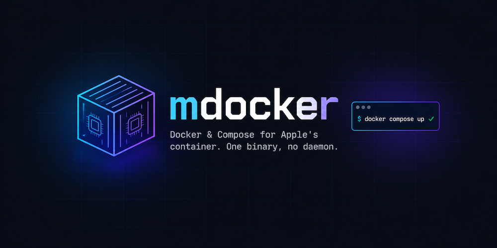

# mdocker

A ~400-line Docker/Compose front end for Apple's [`container`](https://github.com/apple/container).
One binary, no daemon.

## Why

Apple's `container` already runs Linux containers on macOS, and its CLI is close to docker's. mdocker
adds only what's missing:

- **The `docker` command.** Docker verbs `container` spells differently are renamed (`ps`, `images`, `rmi`,
  `login`, ...), the engine starts on demand, and missing `-v` host directories are created as Docker does.
  Everything else passes straight through to `container`.
- **Compose, without `sudo`.** `container` has no compose, and containers can't resolve each other by name
  unless you register a DNS domain with `sudo`. mdocker parses `compose.yaml`, orders services by
  `depends_on`, translates each into `container run`/`build`, and gives services name resolution through a
  per-project hosts file. `up` is idempotent and there is no state file: labels on the containers are the record.

If you only need `run`, `ps` and `build`, use `container` directly.

## Prerequisites

- Apple silicon Mac on macOS 26 (Tahoe) or later
- Xcode with the Swift toolchain (Swift 5.9+), to build from source
- Apple's `container` CLI: `brew install container` (mdocker starts its engine on demand)

## Install

    git clone https://github.com/ddalcu/mdocker && cd mdocker
    swift build -c release
    ln -sf "$PWD/.build/release/mdocker" ~/.local/bin/docker   # or .../mdocker

Make sure `~/.local/bin` is on your `PATH`.

## Usage

- `mdocker <cmd>` — docker verbs map to `container` (`ps`, `images`, `pull`, `rmi`, `login`, ...);
  everything else passes through, so `run`, `build`, `exec`, `logs`, `volume`, `network` are Apple's own.
  The engine is started on demand.
- `mdocker compose [-f file] [-p name] up|down [-v]|ps|logs [-f]|exec` — supports `image`, `build`,
  `command`, `entrypoint`, `environment`, `env_file`, `ports`, `volumes`, `depends_on`, `working_dir`, `user`,
  `container_name`, `labels`, `platform`, `init`, `read_only`, `${VAR:-x}` and `.env`. Unsupported keys warn.

`up` is always detached and idempotent (a config hash label recreates only changed services).
Containers share the engine's default network, so service names resolve via one
per-project `/etc/hosts` (`~/.mdocker/<project>/hosts`) bind-mounted into each container and updated as
services start — no `sudo container system dns create` needed. Services started in the same
`depends_on` tier may not see each other until the file refreshes.

## Mounts and volumes

`container` already matches Docker for `-v src:dst[:ro|:rw|:z|:cached]`, `--mount` (`src`/`dst`/`ro` aliases),
`--tmpfs [path:opts]`, named volumes (created on demand) and anonymous volumes. mdocker adds the rest:

- `-v /host:/ctr` creates a missing host directory (`container` errors); `-v=…` and `-v/host:/ctr` work.
  `--mount type=bind` with a missing path still errors, as in Docker.
- Compose: long-form `volumes:` (`type`, `source`, `target`, `read_only`), `tmpfs:`, `shm_size`, top-level
  `volumes:` with `name:`, `external:` and `labels:`. `down -v` removes the project's volumes and anonymous volumes,
  never external ones.

Known gaps: `--volumes-from` is unsupported by `container`; `docker run --rm` and `docker rm -v` don't remove
anonymous volumes; the `-v` directory creation scans every argument, so a program argument that looks like `-v ./x`
after the image name would also create `./x`.

**Named volumes are ext4 images with a `lost+found` at the root**, unlike Docker's plain directories, so images that
insist on an empty data dir fail on first start. Postgres: set `PGDATA: /var/lib/postgresql/data/pgdata`.

**Known engine issue:** Node's `fs.cpSync` into a bind mount fails with `EACCES` (`cp -a`, `copyFile` and named
volumes are fine). Seen with `ddalcu/agent-orcha`; use a named volume. Every mount form and option fails the same way,
so this is `container`'s virtiofs, not mdocker.

## License

MIT
